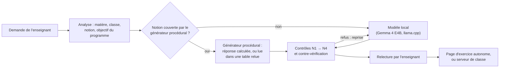

# Arrera School IA

**Un générateur d'exercices pour l'école et le collège, qui tourne entièrement sur le PC de l'enseignant.**

L'enseignant décrit l'exercice comme à un collègue (« un QCM de 8 questions sur le théorème de Pythagore pour des
4e »). Le générateur l'écrit avec un modèle de langue **local**, le contrôle, et le lui donne à relire. Une fois
accepté, l'exercice devient une page autonome que les élèves font en classe, même sans réseau. Aucune donnée ne sort de
la salle.

Projet de master, prévu pour s'intégrer à **Arrera Blue Education**, un logiciel libre pour les salles de classe.

---

## Ce qu'il fait

| | |
|---|---|
| ✍️ **Écrire** | des QCM à partir d'une phrase, du CP à la 3e, avec Gemma 4 E4B (4 bits) sur le PC de l'enseignant, via llama.cpp |
| 🧮 **Juste par construction** | pour les notions couvertes, le **générateur procédural** tire la question et connaît la réponse : il la **calcule** (maths du collège : calcul mental, pourcentages, Pythagore, fractions) ou la **lit dans des tables relues par l'enseignant** (français du CP au CE2 : conjugaison, accords, phrase, vocabulaire ; le temps et l'histoire du CP au CE2 : calendrier, siècles, grandes périodes, repères datés, Préhistoire ; le vivant du CP au CE2 : vivant ou non, régimes, sens, plante, classification, larves, locomotion, chaînes alimentaires ; le corps humain : aliments, squelette, dents, muscles ; la matière et les objets : états de l'eau, conducteurs et isolants, circuit, objets techniques et électriques, ordinateur, grammes et kilogrammes ; la géographie sans carte : continents et océans, points cardinaux, lieux du monde, relief, végétation, fleuve et rivière, zones climatiques, massifs et fleuves de France) |
| 🔍 **Contrôler** | quatre niveaux de validation (N1 → N4) : le JSON, le schéma, la cohérence pédagogique, le **recalcul** (les maths ; en français, les formes verbales inventées et l'ordre alphabétique), puis une **contre-vérification** par le modèle ; une question refusée est reprise |
| 📚 **Suivre le programme** | 713 objectifs des programmes officiels, recopiés mot pour mot (maths et français de 6e et 5e ; du CP au CE2, le français, les sciences et technologie, l'histoire-géographie de 2026) |
| 👩‍🏫 **Relire** | rien n'est publié sans l'enseignant : accepter, modifier, régénérer une question, rejeter ; une banque d'exercices filtrable |
| 🎮 **Faire** | une page HTML autonome, hors ligne, un jeu : une question à la fois, un style « enfant » du CP à la 6e, « collège » de la 5e à la 3e ; tout au clavier ; la voix de Piper ; au CP et au CE1, les questions lues d'office |
| 🧑‍🤝‍🧑 **Suivre les élèves** | classes, élèves (connexion par 4 images du CP à la 6e, par un mot de passe de la 5e à la 3e), réussites et besoins par objectif, groupes, exercices proposés |
| 📄 **S'appuyer sur ses cours** | le modèle lit les passages des cours déposés par l'enseignant (PDF, DOCX, ODT) ; chaque question cite le sien |

---

## Comment ça marche



**Pourquoi un générateur procédural ?** Un petit modèle se trompe : sur 20 demandes réelles de français du CP au CE2,
3 exercices sur 20 écrits par le modèle seul ont été jugés acceptables, contre 20 sur 20 pour le générateur procédural
(les contrôles automatiques avaient laissé passer les 20 du modèle) ; en sciences et en histoire-géographie, 4 sur 20
contre 20 sur 20. Là où c'est possible, le programme fixe la réponse, et le modèle n'est jamais seul juge.

---

## Démarrer

### Ce qu'il faut

- **Python 3.11 ou plus** (développé avec 3.14) ;
- un Mac Apple Silicon, ou un PC sous Linux ; **environ 8 Go de mémoire libre** pour le modèle (~6 Go chargé) ;
- pour les essais dans le navigateur : **Node.js** et **Google Chrome**.

### Installer

```bash
git clone https://github.com/Looiskg/Arrera-School-IA.git
cd Arrera-School-IA
python3 -m venv .venv

# sur un Mac : llama.cpp compilé avec Metal (le calcul passe par la puce graphique)
CMAKE_ARGS="-DGGML_METAL=on" .venv/bin/pip install -r requirements.txt
# sous Linux : la même commande, sans CMAKE_ARGS
```

### Le modèle et la voix (hors du dépôt)

```bash
# le modèle : Gemma 4 E4B QAT 4 bits, GGUF officiel de Google (Apache 2.0, 5,15 Go)
curl -L -o modeles/gemma-4-E4B_q4_0-it.gguf \
  https://huggingface.co/google/gemma-4-E4B-it-qat-q4_0-gguf/resolve/main/gemma-4-E4B_q4_0-it.gguf

# la voix des exercices : Piper, voix « siwis » (CC BY 4.0) ; sans elle, la page utilise la voix du navigateur
mkdir -p modeles/piper && cd modeles/piper
curl -LO https://huggingface.co/rhasspy/piper-voices/resolve/main/fr/fr_FR/siwis/medium/fr_FR-siwis-medium.onnx
curl -LO https://huggingface.co/rhasspy/piper-voices/resolve/main/fr/fr_FR/siwis/medium/fr_FR-siwis-medium.onnx.json
cd ../..
```

Les réglages (le modèle, la voix, les ports, les chemins) sont dans [`config.yaml`](./config.yaml).

### Lancer

```bash
.venv/bin/python -m generateur.donnees.comptes creer-admin   # le premier compte enseignant (une seule fois)
.venv/bin/python -m generateur.interface.api                 # l'interface enseignant : http://127.0.0.1:8000
```

Pour essayer avec une classe fictive de 24 élèves : `.venv/bin/python -m generateur.donnees.demo <identifiant>`.

---

## Les commandes utiles

| Commande | À quoi elle sert |
|---|---|
| `python -m generateur.interface.api` | l'interface enseignant (port 8000) |
| `python -m generateur.classe` | le serveur de classe, la porte des élèves (port 8001) |
| `python -m generateur.moteur.generation --demande "…"` | générer un exercice sans l'interface |
| `python -m generateur.donnees.comptes …` | les comptes : `creer-admin`, `creer`, `lister`, `reinitialiser`, `debloquer`, `supprimer` |
| `python -m generateur.procedural.tables` | l'état des tables de référence du générateur ; `… relire <matière>/<table> --par "…"` pour en valider une après relecture |
| `python -m generateur.outils.mesurer` | les durées et la réussite, par modèle et par machine |
| `python -m generateur.entrainement aveugle chemins --demandes …` | comparer à l'aveugle le modèle seul et le générateur procédural |
| `python -m generateur.interface.api --aveugle` | relire une comparaison à l'aveugle (port 8003) |

Les commandes se lancent depuis la racine du dépôt, avec le Python du projet (`.venv/bin/python`).

---

## Les tests

```bash
.venv/bin/python -m pytest -q          # plus de 1 600 tests, en deux minutes environ, sans modèle
node tests/navigateur/essai.mjs        # l'interface enseignant, dans Chrome, sur une copie de la banque
node tests/navigateur/exercice.mjs     # la page d'exercice : clavier, animations, voix, téléphone
```

---

## L'organisation du dépôt

```
generateur/
├── moteur/          la chaîne : analyse de la demande, génération, validation (N1 → N4), banque, rendu, voix
├── procedural/      le générateur procédural : maths/, francais/, histoire_geo/, sciences_et_technologie/, et les
│                    tables de référence relues (donnees/)
├── programmes/      les programmes officiels, recopiés mot pour mot
├── types/qcm/       le type « QCM » : schéma, prompt, exemple, gabarit de la page d'exercice
├── interface/       l'interface enseignant (FastAPI) et ses pages
├── classe/          le serveur de classe, séparé, sans aucune route enseignant
├── donnees/         la base SQLite : comptes, classes, élèves, suivi, cours
├── cours/           la lecture des cours déposés, dans un processus limité
├── entrainement/    le lot d'entraînement, la relecture à l'aveugle, l'adaptateur LoRA (expérimental)
└── outils/          les mesures
scripts/             les scripts qui fabriquent et vérifient les données (tables, programmes, lexique)
tests/               les tests (pytest) et les essais dans le navigateur
```

Ne sont jamais dans le dépôt : le modèle et les voix (`modeles/`), la base et ses sauvegardes (`donnees/`), la banque
d'exercices (`banque/`).

---

## Les données des élèves

- **Tout reste sur le PC de l'enseignant** : le modèle, la banque, la base. Aucun service en ligne, aucune donnée envoyée.
- Les élèves se connectent par un code (4 images, ou un mot de passe de la 5e à la 3e) ; seuls le nom, le prénom, la
  classe et les réponses sont gardés, effacés en fin d'année.
- **Tant que l'analyse d'impact (RGPD) n'est pas validée par l'établissement, seuls des élèves fictifs sont utilisés.**

---

## Les licences

| | Licence |
|---|---|
| Le modèle Gemma 4 E4B (GGUF de Google, hors du dépôt) | Apache 2.0 |
| Piper (`piper-tts`, la voix) | GPL-3.0 |
| Les voix « siwis » et « upmc » de Piper (hors du dépôt) | CC BY 4.0, CC BY-SA 4.0 |
| La liste des mots de **Lexique 3.83** ([`generateur/moteur/validation/lexique/`](./generateur/moteur/validation/lexique/LISEZMOI.md)) | CC BY-SA 4.0 |
| Les polices Andika et Atkinson Hyperlegible ([`generateur/types/qcm/polices/`](./generateur/types/qcm/polices/)) | SIL Open Font License |

La licence du code de ce dépôt reste à fixer avec Arrera Blue Education, un logiciel libre.
